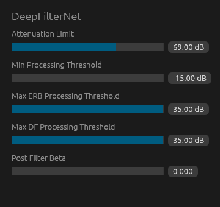

# Deepfilter-VST

This repository contains a VST3 and CLAP plug-in for the [DeepFilterNet](https://github.com/Rikorose/DeepFilterNet) machine learning model, as the original model was only implemented as a LADSPA plugin. In some of my testing, this plugin had much improved performance compared to the LADSPA plugin, although I don't see a reason for this as the same model is used for both.



## Controls

The plugin has a small editor with a slider for each parameter. Hovering over a slider explains what it does in practice. The controls are the same ones that the official LADSPA plugin and [Easy Effects](https://wwmm.github.io/easyeffects/plugins/deepfilternet.html) contain.

| Parameter | Range | Default | Description |
| --- | --- | --- | --- |
| Attenuation Limit | 0.1 – 100 dB | 70 dB | The maximum amount the noise is reduced by. 100 dB means no limit. Lower values sound more natural, but this should not be set too low or the plugin will not do anything. |
| Min Processing Threshold | -15 – 35 dB | -15 dB | Moments where the estimated signal-to-noise ratio is below this are treated as pure noise and silenced. Raising it works a bit like a noise gate. |
| Max ERB Processing Threshold | -15 – 35 dB | 35 dB | Moments where the estimated signal-to-noise ratio is above this are passed through untouched. |
| Max DF Processing Threshold | -15 – 35 dB | 35 dB | Moments where the estimated signal-to-noise ratio is above this skip the second, finer filtering stage. Lowering it saves CPU. |
| Post Filter Beta | 0 – 0.05 | 0 (off) | Strength of an extra filter that further reduces leftover noise, at the cost of a slightly thinner voice. |

## Notes

The plugin has a stereo input and output. Any sample rate works, as the audio is resampled to the model's 48 kHz internally.

The plugin adds about 80 ms of latency. This comes from the model itself (30 ms), the resamplers (10 ms) and a buffer that gives the model time to run on a separate thread (40 ms). The buffer size is not dynamically configurable, but can technically be changed.

If the model fails for any reason, the plugin passes the audio through unprocessed.

This plugin should be a decent alternative to RNNoise, which doesn't exactly have the best results in my own experience. However, the model used is much more demanding.  
In my personal testing a properly compiled RNNoise plugin was about 3 times as performant as this plugin. I would recommend testing both options. If you notice that this plugin has better results, it should still be real time capable on modern CPUs.

nice-plug also supports CLAP plugins, but it is mostly untested. Regardless, it should be automatically built alongside the VST plugin.

## Building

After installing [Rust](https://rustup.rs/), you can compile deepfilter-vst as follows:

```shell
cargo xtask bundle deepfilter-vst --release
```

The plugins are created in `target/bundled/` as `deepfilter-vst.vst3` and `deepfilter-vst.clap`.
